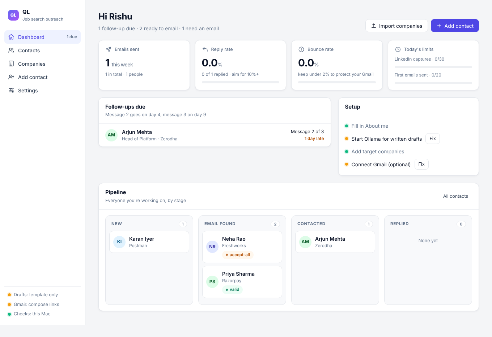
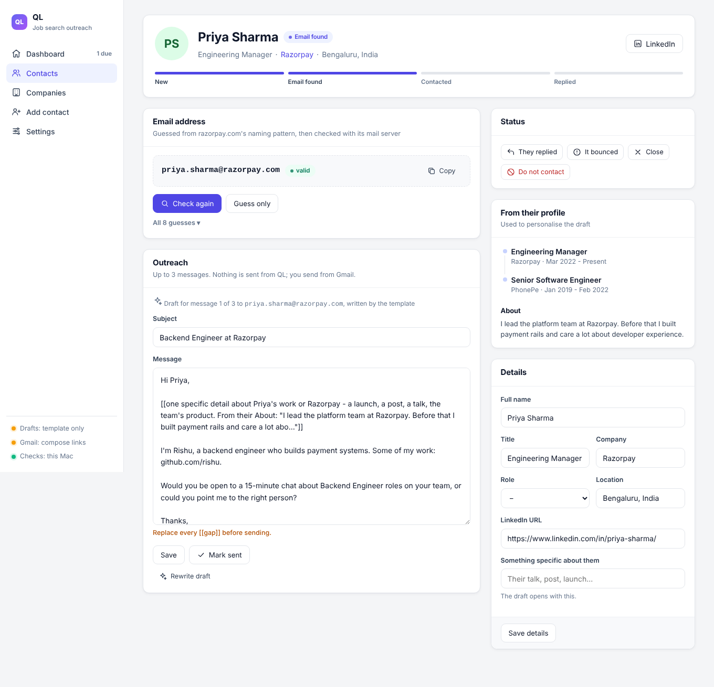
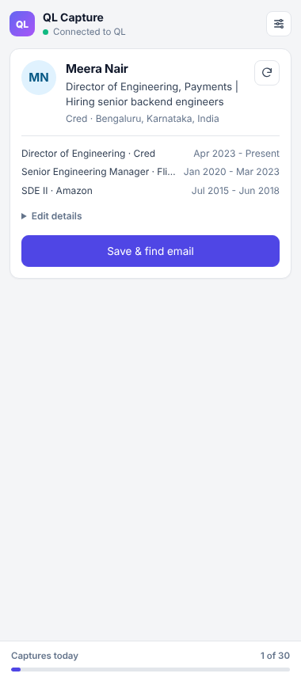

<p align="center"></p>

<h1 align="center">Hunterly</h1>

<p align="center"><b>Find the hiring manager, get their work email, and write to them directly.</b><br>
A Chrome extension plus a small local backend. Free, open source, and private: your data stays on your computer.</p>

<p align="center">
<a href="https://github.com/Rishurajgautam24/hunterly/actions/workflows/ci.yml"></a>
<a href="LICENSE"></a>
<a href="CONTRIBUTING.md"></a>

<a href="https://github.com/Rishurajgautam24/hunterly/releases/latest"></a>
</p>

## Watch the 60-second intro

https://github.com/user-attachments/assets/f9051241-0d4e-4964-99c4-39d9a2b1b760

## How it works

1. **Capture**: open a LinkedIn profile and the Hunterly side panel reads it. One click saves the person.
2. **Find the email**: Hunterly tries ~30 naming patterns, learns each company's format from addresses you already know, and checks the best guesses with the company's mail server. It never sends an email to do this.
3. **Draft**: a short, personal first message, written by a local AI model (Ollama) on your machine. You review it and send it from Gmail yourself.
4. **Track**: follow-ups on day 4 and day 9, replies, bounces and a do-not-contact list, all in one pipeline.

No spam, no auto-send, no tracking pixels.

**[Download the latest release](https://github.com/Rishurajgautam24/hunterly/releases/latest)**: the extension zip plus the source code for the backend. Setup takes about 5 minutes; the steps are [below](#requirements).

## Features

What's in this first build (the PRD's MVP plus the extension):

| Area | What it does |
| --- | --- |
| Capture | Side-panel extension. With the panel open, it reads the LinkedIn profile you're viewing: name, headline, title, company, location, About and up to 6 roles. One click saves it and finds the email. It only reads pages you open (no crawling, no extra requests to LinkedIn); max 30 saves a day. Manual entry works without LinkedIn. |
| Companies | Target list, CSV import, domain suggestions with mail-server (MX) check, "known addresses" that teach Hunterly each company's email pattern. |
| Email finder | Builds up to 30 candidate addresses from ~30 patterns (first.last, flast, numbered ones like ssingh1, middle initials, reversed...), ranked by what's common and by real addresses you've confirmed at that company. Checks the top 10 with the company's mail server without sending anything, and falls back to Hunter (free tier) when your network blocks that. You can edit or type any address yourself. |
| Drafts | Local LLM through Ollama (private, free). Falls back to a fill-in template if Ollama isn't running. Drafts with `[[gaps]]` can't be sent. |
| Sending | "Open in Gmail compose" (no setup), or real Gmail drafts through the Gmail API (drafts only — Hunterly never sends and never reads your mail). |
| Tracker | Stages, follow-ups on day 4 and 9, 3-message limit, bounce handling (switches to the next address), do-not-contact list, reply and bounce rates. |
| Your own emails | Know the address already? Type it: in the extension under **Edit details or type their email**, on a contact's page, or straight into the Email column of the Contacts list. Tick "I know it's right" and Hunterly learns that company's pattern for everyone else there. |
| Export | **Export CSV** on the Contacts page (respects the stage filter) and on the Companies page. Opens in Excel or Google Sheets. |

Not yet built (next phase): Laya classification (contact role, reply triage, draft checks, job fit), Hunter/Snov.io fallback, reading replies from Gmail.

## Requirements

- Python 3.12 (uv installs it for you)
- [uv](https://docs.astral.sh/uv/)
- Google Chrome (or another Chromium browser: Edge, Brave, Arc)
- Optional: [Ollama](https://ollama.com) for written drafts

Works on **macOS, Windows 10/11 and Linux**; CI runs the tests on all three.

## 1. Start the backend

**macOS / Linux**

```bash
curl -LsSf https://astral.sh/uv/install.sh | sh     # or on macOS: brew install uv
cd backend
uv sync                          # creates .venv with Python 3.12
cp .env.example .env             # optional settings
uv run hunterly serve            # http://127.0.0.1:8765
```

**Windows (PowerShell)**

```powershell
powershell -ExecutionPolicy ByPass -c "irm https://astral.sh/uv/install.ps1 | iex"   # or: winget install astral-sh.uv
# open a new terminal so uv is on PATH, then:
cd backend
uv sync
Copy-Item .env.example .env      # optional settings
uv run hunterly serve            # http://127.0.0.1:8765
```

Open http://127.0.0.1:8765, go to **Settings** and fill in "About me" (name, target role, one-line pitch, links, signature). Every draft uses it.

Your data lives in a `.hunterly` folder in your home directory: `~/.hunterly` on macOS/Linux, `C:\Users\<you>\.hunterly` on Windows. Set `HUNTERLY_DATA_DIR` to move it.

## 2. Local drafts with Ollama

Install Ollama from [ollama.com](https://ollama.com/download) (macOS: `brew install ollama`; Windows: `winget install Ollama.Ollama`; Linux: the install script on the site), then:

```bash
ollama serve               # if the app isn't already running
ollama pull llama3.2:3b    # small enough for an 8 GB laptop; set HUNTERLY_OLLAMA_MODEL to change
```

The dashboard shows whether Ollama is ready. Without it you still get the template.

## 3. Load the extension

1. Download `hunterly-extension-vX.Y.Z.zip` from the [latest release](https://github.com/Rishurajgautam24/hunterly/releases/latest) and unzip it. (Working from a clone? Use the repo's `extension` folder instead.)
2. Chrome → `chrome://extensions` (Edge: `edge://extensions`) → turn on **Developer mode** → **Load unpacked** → choose the unzipped folder.
3. Pin "Hunterly Capture" and click it to open the side panel. Open any LinkedIn profile: the panel fills itself in.
4. Click **Save & find email**. If Hunterly doesn't know the company's email domain yet, pick one of the suggested domains (or type it), and the email check runs straight away.

The panel only reads the profile tab you're looking at, while it's open (turn auto-read off under the settings icon to read on demand). It talks only to `127.0.0.1:8765`. If a field comes out wrong, open **Edit details** before saving; LinkedIn changes its page layout from time to time.

## 4. Mail-server checks and port 25

Checking an address means talking to the company's mail server on port 25. Many home ISPs block that port. Test it (same commands on every OS):

```bash
uv run hunterly port25           # "open" or "blocked"
uv run hunterly check someone@company.com other@company.com
```

If it's **open**, you're done; consider setting `HUNTERLY_SMTP_HELO_HOST` and `HUNTERLY_SMTP_MAIL_FROM` to a domain you own, since some servers distrust `localhost`.

If it's **blocked**, run the verifier on a small cloud VM whose provider allows outbound port 25 (many big clouds block it too — check first):

```bash
# on the VM
curl -LsSf https://astral.sh/uv/install.sh | sh
# copy the backend folder to the VM, then:
cd backend
uv sync
HUNTERLY_VERIFIER_KEY=<long random string> HUNTERLY_SMTP_HELO_HOST=<vm hostname> uv run hunterly-verifier   # listens on 127.0.0.1:8766

# on your computer: tunnel to it (ssh is built into macOS, Linux and Windows 10/11), then add to backend/.env
ssh -N -L 8766:127.0.0.1:8766 you@your-vm
#   HUNTERLY_VERIFIER_URL=http://127.0.0.1:8766
#   HUNTERLY_VERIFIER_KEY=<same string>
```

**Hunter backup (recommended if port 25 is blocked):** sign up free at hunter.io (50 credits a month), copy your API key, and paste it on Hunterly's Settings page. When the mail-server check can't answer, Hunterly asks Hunter instead (1 credit, only charged when Hunter returns an address).

Statuses: **valid** (server confirmed), **accept-all** (server accepts everything, so it's the best guess), **unknown** (no answer: greylisting, blocks, port 25), **invalid** (server said no such mailbox). Without port 25, use **Guess only** — candidates are still ranked by pattern, and adding a few known addresses at the company makes the top guess much better.

## 5. Gmail drafts (optional)

1. Google Cloud console → new project → enable the **Gmail API**.
2. OAuth consent screen: External, add yourself as a test user.
3. Credentials → OAuth client ID → **Desktop app** → download JSON to `credentials.json` in your data folder (`~/.hunterly`, or `C:\Users\<you>\.hunterly` on Windows).
4. `uv run hunterly gmail-auth` and approve. Only the `gmail.compose` scope is requested.

Then the contact page shows **Save and create Gmail draft**. You still press send in Gmail, then click **Mark sent** in Hunterly.

## Daily routine

1. Dashboard → follow-ups due today first.
2. Add 3–5 companies; set their domains.
3. Capture 1–2 hiring managers per company (not recruiters).
4. Find email → write draft → add one specific detail → send from Gmail → **Mark sent**.
5. When someone answers: **They replied**. If it bounces: **It bounced** (Hunterly moves to the next address). If they say no: **Do not contact**.

## Guardrails (built in)

- LinkedIn: reads only the profile you're viewing (no crawling, scrolling or extra requests), saves only on click, 30 saves a day.
- Email: at most 20 new first emails a day, 3 messages per person, no open tracking, nothing sent automatically.
- Data stays in `hunterly.db` inside your `.hunterly` data folder, on your own computer. The web app only answers on 127.0.0.1, forms carry a per-install token, and the extension API accepts JSON from the extension only.

## Development

```bash
cd backend
uv run pytest              # 51 tests
uv run ruff check src tests
```

Layout: `backend/src/hunterly/` — `app.py` (pages + API), `services.py` (rules), `finder/` (names, patterns, domains, SMTP check, verifier), `drafts.py` (Ollama + template), `gmail.py`, `verifier_worker.py` (VM service). `extension/` — MV3 side panel.

## Contributing

Contributions are welcome. Read [CONTRIBUTING.md](CONTRIBUTING.md), then open an issue or a pull request. Please follow the [Code of Conduct](CODE_OF_CONDUCT.md).

## Screenshots



| Contact page | Extension |
| --- | --- |
|  |  |

## License

[MIT](LICENSE) © 2026 Rishu
